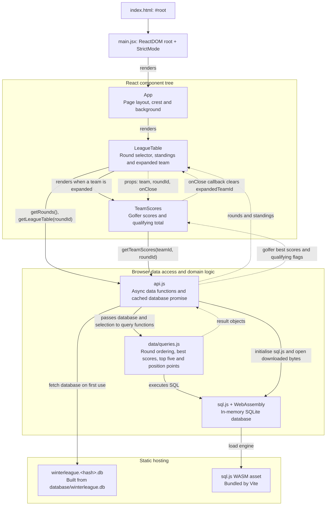

# React application components

The application is a single-page React app built with Vite. React owns the
selection and display state, while SQL queries calculate the league results in
the browser from a downloaded SQLite database.

## Component and module structure

Solid arrows show rendering or function calls; dotted arrows show returned data,
props, or callbacks as labelled.

The `api.js` name refers to a local JavaScript module. Its network request
downloads a static database file; the league queries run inside the browser.
The source database lives in `database/winterleague.db` at the repository root;
the build publishes a content-hashed copy. During development Vite serves the
source database directly. `VITE_DB_FILE=winterleague.test.db` selects the test-data
snapshot in `database/winterleague.test.db`, served by the same development plugin.
The module shares one database-loading promise across callers and clears it if
loading fails so a later call can retry.

## State ownership

| Component | State and responsibility |
| --- | --- |
| `App` | Provides the page shell and branding; has no local state. |
| `LeagueTable` | Owns `rounds`, `selectedRound`, `table`, `expandedTeamId`, `loading` and `error`. Loads rounds on mount, selects the last round in date order, and reloads standings when the selection changes. Clicking a team toggles its score panel. |
| `TeamScores` | Owns `scores`. Loads scores when `teamId` or `roundId` changes, highlights qualifying golfers, and calculates the displayed weekly total from their best scores. Calls the parent's `onClose` callback when closed. |

Selection state lives in `LeagueTable` and flows down as props. There is no
router, shared context, or external state store in the current component tree.

## User interaction and data flow

```mermaid
sequenceDiagram
    actor User
    participant L as LeagueTable
    participant T as TeamScores
    participant A as api.js
    participant Q as data/queries.js
    participant D as Browser SQLite

    Note over A,D: First data request initialises sql.js and downloads the database, later requests reuse it
    L->>A: getRounds()
    A->>Q: getRounds(db)
    Q->>D: Select rounds ordered by start_date
    D-->>Q: Round rows
    Q-->>A: roundId, name
    A-->>L: Rounds
    L->>L: Select latest round by date
    L->>A: getLeagueTable(selectedRound)
    A->>Q: getLeagueTableByPosition(db, roundId)
    Q->>D: Calculate cumulative position points
    D-->>Q: Team standings
    Q-->>A: teamId, teamName, totalPoints
    A-->>L: Standings

    User->>L: Click a team
    L->>T: Render with team, roundId and onClose
    T->>A: getTeamScores(teamId, roundId)
    A->>Q: getTeamScores(db, teamId, roundId)
    Q->>D: Select golfer best scores and qualifying flags
    D-->>Q: Golfer results
    Q-->>A: golferId, golferName, bestScore, qualifying
    A-->>T: Scores
    T->>T: Sum qualifying scores for weekly total

    User->>L: Select another round
    Note over L,T: Reload standings and, if expanded, the team's scores for the selected round

    User->>T: Close
    T->>L: onClose()
    L->>L: Clear expandedTeamId and unmount TeamScores
```

`LeagueTable` displays an error message for round or standings failures.
`TeamScores` currently logs score-loading failures to the console.

See the [entity diagram](entity-diagram.md) for stored tables, relationships and
scoring rules. Implementation sources:
[`main.jsx`](../src/main.jsx), [`App.jsx`](../src/App.jsx),
[`LeagueTable.jsx`](../src/components/LeagueTable.jsx),
[`TeamScores.jsx`](../src/components/TeamScores.jsx),
[`api.js`](../src/api.js), and [`queries.js`](../src/data/queries.js).
