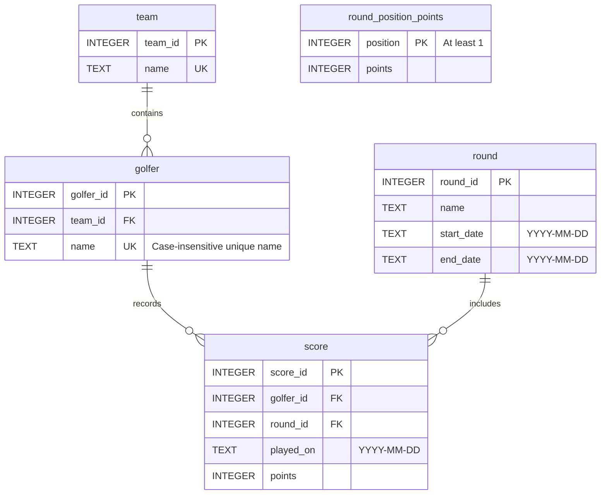

# Winter League entity diagram

For the React component tree and runtime data flow, see the
[application component diagram](application-diagram.md).

The front end loads a bundled SQLite database through `sql.js` in
[`src/api.js`](../src/api.js). This diagram describes its stored entities, based on
[`database/schema.sql`](../../database/schema.sql) and the queries in
[`src/data/queries.js`](../src/data/queries.js).

`PK` means primary key, `FK` foreign key, and `UK` unique key.
Each team can have zero or more golfers; each golfer belongs to exactly one team.
Each score belongs to exactly one golfer and one round; golfers and rounds can
have zero or more scores. All non-key fields are required by the schema.

Additional constraints:

- A score is unique by `(golfer_id, round_id, played_on)`, allowing multiple
  scores for a golfer in a round on different dates.
- A round's start date must be on or before its end date.
- Foreign keys declare cascading deletes from teams to golfers, and from golfers
  or rounds to scores.
- `round_position_points` is a standalone lookup table. The queries join its
  `position` to a calculated team position; it has no stored foreign-key
  relationship to another entity. Positions without a lookup entry earn zero points.

## Calculated data exposed to React

These query results are calculated or projected from the entities above; they
are not additional stored tables.

| API function | Result fields | Derivation |
| --- | --- | --- |
| `getRounds()` | `roundId`, `name` | Rounds ordered by `start_date`. |
| `getLeagueTable(roundId)` | `teamId`, `teamName`, `totalPoints` | Sum the top five golfers' best scores per team and round, rank teams within each round, then sum position points through the selected round by start date. Teams with no scores have zero points. |
| `getTeamScores(teamId, roundId)` | `golferId`, `golferName`, `bestScore`, `qualifying` | Each scoring golfer's maximum points in the selected round; the top five qualify, ordered by score descending and then name. |

Tied team round scores share the higher position using SQL `RANK()` (for example,
1, 1, 3). The older `getLeagueTableByTotalScore` query sums team round scores
directly, but the current API uses position points.
